# RemoteUpdate 사용 설명서 (1차 버전)

RemoteUpdate 는 **프로젝트별 초기 세팅 가이드와 업데이트 파일을 한곳에 올려 두고, 현장 담당자가 받아 가는** 사내 웹 시스템입니다.
이 문서는 화면 사용법을 역할(직원 · 개발자 · 관리자)별로 설명합니다. 서버 설치·실행·백업 같은 운영 작업은 Backend 저장소의 `docs/operations.md` 를 보세요.

> 화면 그림은 예시 데이터(스마트 관제 시스템, 김개발, 이영업 등)로 찍은 것입니다.

## 목차

1. [한눈에 보기](#1-한눈에-보기)
2. [접속과 로그인](#2-접속과-로그인)
3. [화면 구성](#3-화면-구성)
4. [직원 — 가이드 보기와 파일 받기](#4-직원--가이드-보기와-파일-받기)
5. [개발자 — 가이드·업데이트 등록](#5-개발자--가이드업데이트-등록)
6. [관리자 — 프로젝트·사용자·허용 IP](#6-관리자--프로젝트사용자허용-ip)
7. [처음 운영을 시작할 때 (관리자 체크리스트)](#7-처음-운영을-시작할-때-관리자-체크리스트)
8. [오류 메시지와 해결](#8-오류-메시지와-해결)
9. [자주 묻는 질문](#9-자주-묻는-질문)

---

## 1. 한눈에 보기

### 1.1. 무엇을 하는 시스템인가

| 구분 | 내용 |
|---|---|
| **프로젝트** | 현장에 설치하는 제품 단위 (예: 스마트 관제 시스템). 관리자가 만듭니다. |
| **초기 세팅 가이드** | 현장 PC 를 처음 준비하는 방법(설치 순서, 설정 값 등). 본문(마크다운) + 첨부 파일 1개 |
| **업데이트** | 버전별 배포 파일(zip 등)과 변경 내용. 개발자가 올리고, 현장 담당자가 받습니다. |
| **다운로드 이력** | 누가 · 언제 · 어디서(IP) · 어떤 버전을 받았는지 자동 기록 |

### 1.2. 역할과 권한

계정마다 역할이 하나 있고, 위 역할은 아래 역할의 기능을 모두 쓸 수 있습니다 (관리자 ⊃ 개발자 ⊃ 직원).

| 기능 | 직원 | 개발자 | 관리자 |
|---|:-:|:-:|:-:|
| 프로젝트·가이드 보기, 가이드 첨부 받기 | ✔ | ✔ | ✔ |
| 업데이트 보기·다운로드 (배포 중인 것만) | ✔ | ✔ | ✔ |
| 중단된 업데이트 보기, 변경 이력 보기 | | ✔ | ✔ |
| 가이드 등록·수정 | | ✔ | ✔ |
| 업데이트 등록·수정·배포 중단/재개 | | ✔ | ✔ |
| 다운로드 이력 조회 | | ✔ | ✔ |
| 프로젝트 등록·수정 | | | ✔ |
| 사용자 관리 (계정 발급, 역할, 비밀번호 초기화, 사용 중지) | | | ✔ |
| 허용 IP 관리 | | | ✔ |

> **허용 IP 제한:** 관리자가 IP 제한을 켜면, 개발자·관리자의 **등록·수정 같은 관리 기능은 허용된 위치(사무실 등)에서만** 됩니다. 조회와 다운로드는 어디서나 됩니다. → [6.3](#63-허용-ip)

---

## 2. 접속과 로그인

### 2.1. 접속 주소

관리자에게 받은 주소(예: `http://서버주소:8080`)를 Chrome · Edge 로 엽니다. 로그인하지 않았으면 로그인 화면이 나옵니다.

### 2.2. 로그인

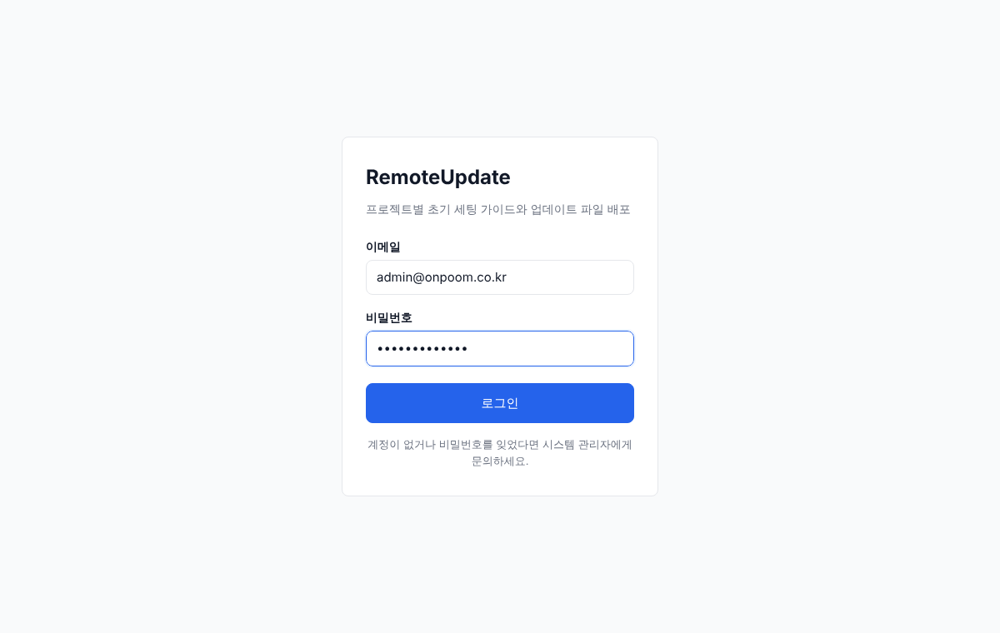

1. **이메일**(로그인 ID)과 **비밀번호**를 입력합니다.
2. **로그인** 을 누르면 프로젝트 목록으로 이동합니다. 로그인 전에 열려던 주소가 있었다면 그 화면으로 바로 갑니다.

- 계정은 스스로 만들 수 없습니다. 관리자에게 요청하세요.
- 로그인 후 **30분 동안 아무것도 하지 않으면** 자동 로그아웃됩니다. "로그인 시간이 만료되었습니다" 가 보이면 다시 로그인하면 됩니다.

### 2.3. 처음 로그인 — 비밀번호 바꾸기

관리자가 발급한 **임시 비밀번호**로 처음 로그인하면, 비밀번호를 바꾸기 전에는 다른 화면을 쓸 수 없습니다.

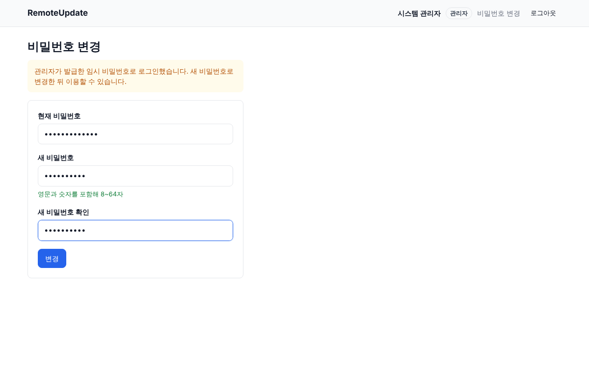

1. **현재 비밀번호**: 받은 임시 비밀번호
2. **새 비밀번호**: **영문과 숫자를 포함해 8~64자** (조건을 만족하면 안내 글자가 초록색으로 바뀜)
3. **새 비밀번호 확인**: 같은 값을 한 번 더
4. **변경** → 프로젝트 목록으로 이동

### 2.4. 비밀번호를 5번 틀리면

같은 계정으로 **5번 연속 틀리면 15분 동안 잠깁니다.** 15분이 지나면 다시 로그인할 수 있고, 급하면 관리자에게 **비밀번호 초기화**를 요청하세요(초기화하면 잠금도 풀림).

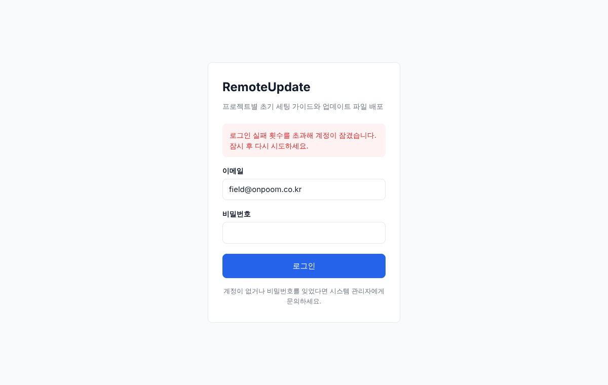

### 2.5. 비밀번호 변경 · 로그아웃

- 오른쪽 위 **비밀번호 변경** 에서 언제든 바꿀 수 있습니다. 규칙은 2.3 과 같고, 현재 비밀번호와 같은 값은 쓸 수 없습니다.
- 오른쪽 위 **로그아웃** 을 누르면 바로 로그아웃됩니다. 공용 PC 에서는 꼭 로그아웃하세요.

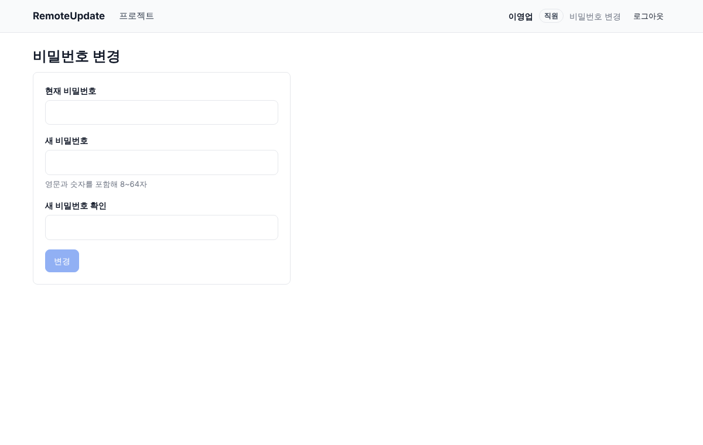

### 2.6. 비밀번호를 잊었을 때

관리자에게 **비밀번호 초기화**를 요청하세요. 새 임시 비밀번호를 받아 2.3 처럼 로그인 후 바꾸면 됩니다.

---

## 3. 화면 구성

| 위치 | 내용 |
|---|---|
| 왼쪽 위 **RemoteUpdate** | 누르면 프로젝트 목록으로 |
| 상단 메뉴 | **프로젝트**(모두), **다운로드 이력**(개발자 이상), **사용자 관리**·**허용 IP**(관리자) — 역할에 따라 보이는 메뉴가 다름 |
| 오른쪽 위 | 내 이름, 역할(직원/개발자/관리자), 비밀번호 변경, 로그아웃 |
| 화면 위 경로 | `프로젝트 / 스마트 관제 시스템 / 1.1.0` 처럼 현재 위치. 앞 단계를 누르면 그 화면으로 |
| 노란 안내줄 | 허용되지 않은 위치에서 개발자·관리자가 접속하면 표시 (→ 6.3) |

---

## 4. 직원 — 가이드 보기와 파일 받기

현장에 나가는 담당자(영업 등)가 주로 쓰는 기능입니다.

### 4.1. 프로젝트 고르기

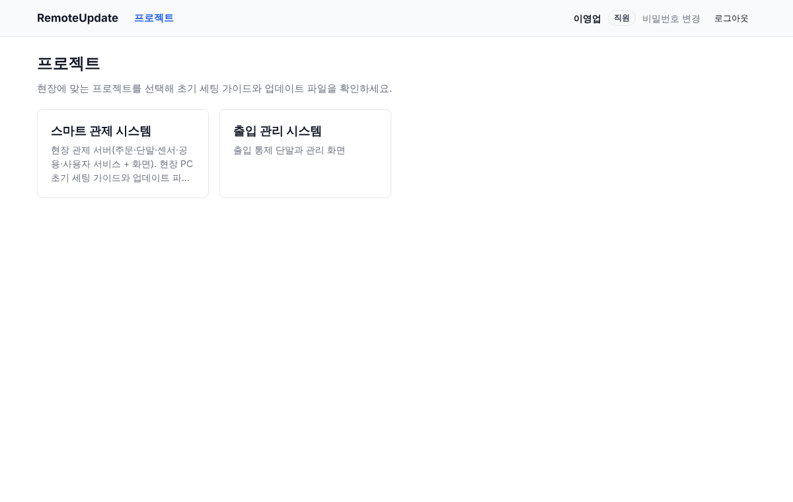

로그인하면 **프로젝트 목록**이 나옵니다. 설치·업데이트할 현장 제품의 카드를 누릅니다.

### 4.2. 프로젝트 화면

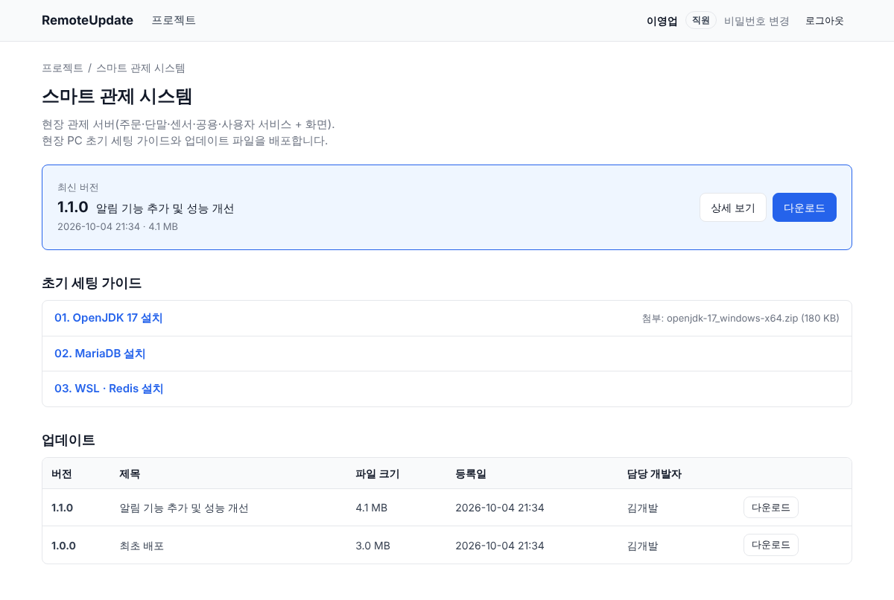

| 영역 | 설명 |
|---|---|
| **최신 버전** (파란 상자) | 지금 배포 중인 가장 최근 버전. **다운로드** 를 누르면 바로 받고, **상세 보기** 로 변경 내용을 확인 |
| **초기 세팅 가이드** | 현장 PC 를 처음 준비할 때 순서대로 보는 문서. 제목을 누르면 본문, 오른쪽 **첨부:** 를 누르면 첨부 파일을 바로 받음 |
| **업데이트** | 배포 중인 버전 목록(최신순). 줄을 누르면 상세 화면, **다운로드** 를 누르면 바로 받음. 많으면 아래쪽에 페이지 번호 |

### 4.3. 가이드 보기

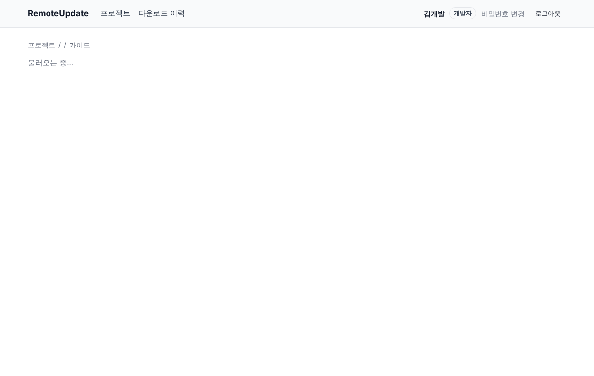

- 본문은 제목·목록·코드 상자로 정리되어 보입니다. 코드 상자 안의 명령은 그대로 복사해 쓰면 됩니다.
- 첨부 파일이 있으면 오른쪽 위 **첨부 파일 받기** 버튼이 나옵니다.
- 가이드 제목 앞의 번호(01, 02 …)는 **진행 순서**입니다. 위에서부터 차례로 따라 하세요.

### 4.4. 업데이트 받기

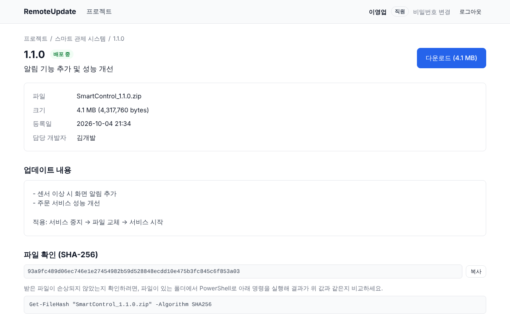

1. 버전, 제목, **업데이트 내용**(변경 사항 · 적용 방법 · 주의 사항)을 먼저 읽습니다.
2. 오른쪽 위 **다운로드 (크기)** 를 누릅니다. 큰 파일은 시간이 걸릴 수 있습니다.
3. 받은 기록(누가 · 언제 · IP)은 자동으로 남습니다.

### 4.5. 받은 파일이 온전한지 확인 (SHA-256)

인터넷이 불안정한 현장에서는 파일이 깨진 채 받아질 수 있습니다. 설치 전에 확인하면 안전합니다.

1. 상세 화면 **파일 확인 (SHA-256)** 의 **복사** 를 눌러 기준 값을 복사합니다.
2. 받은 파일이 있는 폴더에서 빈 곳을 `Shift + 오른쪽 클릭` → **PowerShell 창 열기** (또는 **터미널에서 열기**)
3. 화면에 나온 명령을 그대로 실행합니다. 예:
   ```powershell
   Get-FileHash "SmartControl_1.1.0.zip" -Algorithm SHA256
   ```
4. 나온 `Hash` 값이 화면의 값과 **같으면 정상**입니다 (대소문자는 무시). 다르면 다시 받으세요.

---

## 5. 개발자 — 가이드·업데이트 등록

개발자는 직원 기능에 더해 아래 기능을 씁니다. 등록·수정은 **허용된 위치**에서만 됩니다(IP 제한을 켠 경우, → 6.3).

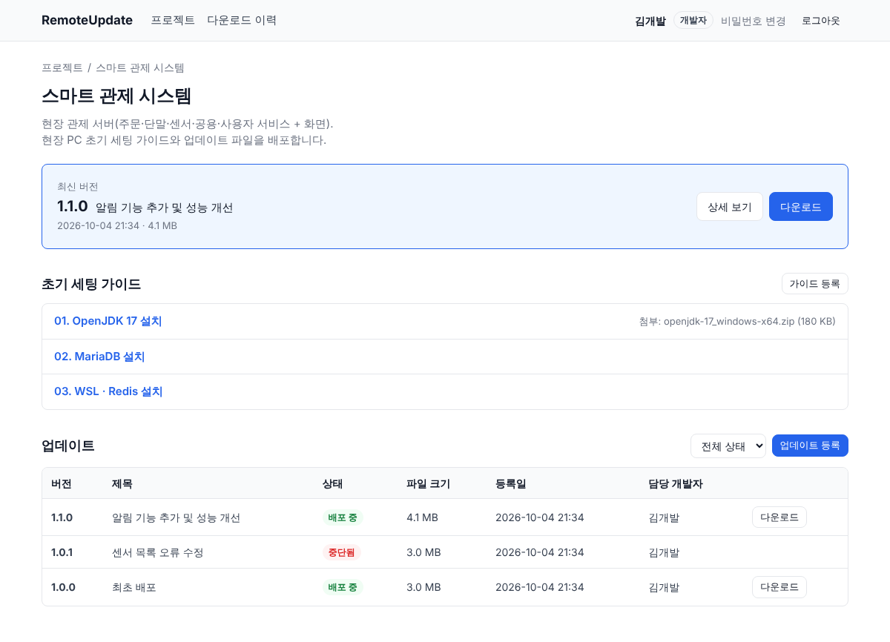

개발자에게는 프로젝트 화면에 **가이드 등록**, **업데이트 등록**, 업데이트 **상태** 열과 **상태 필터**(전체 / 배포 중 / 중단됨)가 추가로 보입니다.

### 5.1. 가이드 등록

프로젝트 화면 → **초기 세팅 가이드** 오른쪽 **가이드 등록**

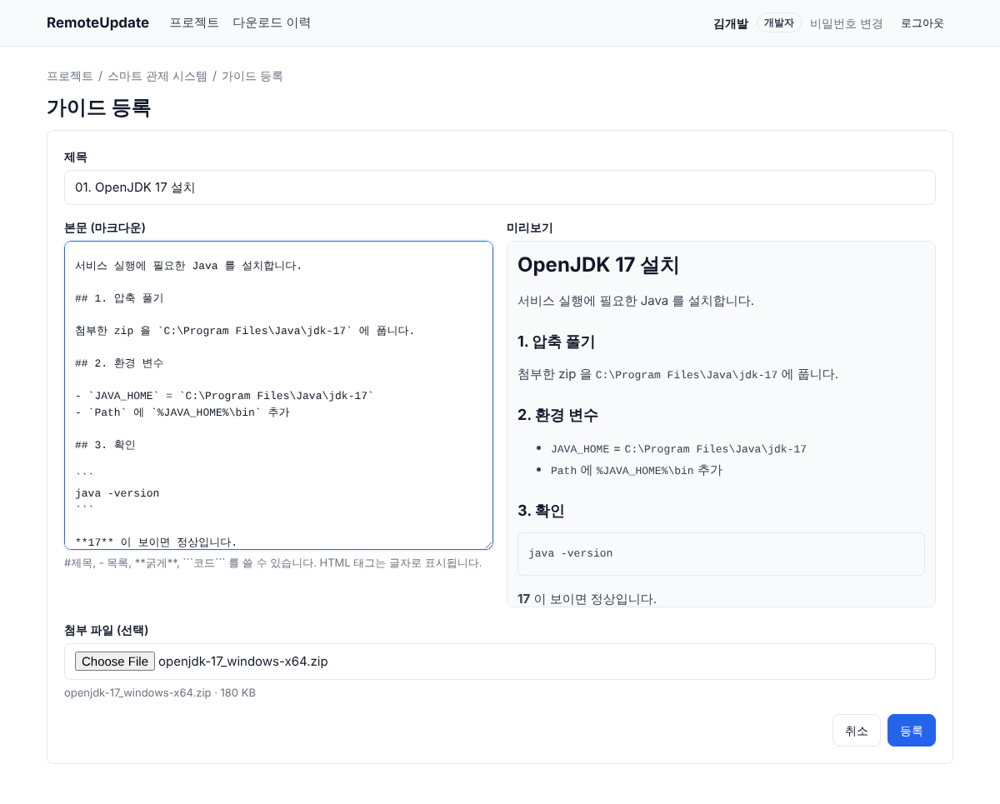

| 항목 | 설명 |
|---|---|
| **제목** (필수) | 최대 200자. 목록은 **등록한 순서**대로 보이므로 진행 순서대로 등록하고, 앞에 번호를 붙이면 알아보기 쉽습니다 (`01. OpenJDK 17 설치`). |
| **본문 (마크다운)** | 최대 10만 자. 오른쪽 **미리보기**에 바로 결과가 보입니다. |
| **첨부 파일** (선택) | 1개. 설치 파일·문서 등. 허용 형식과 최대 크기는 선택 칸 아래에 표시 (기본: zip, exe, msi, pdf, md / 500MB) |

**마크다운 간단 사용법**

| 이렇게 쓰면 | 이렇게 보임 |
|---|---|
| `# 제목`, `## 소제목` | 큰 제목, 작은 제목 |
| `- 항목` | 점 목록 |
| `1. 항목` | 번호 목록 |
| `**굵게**` | **굵게** |
| `` `C:\OnpoomApp` `` | 글자 사이 코드 표시 |
| ` ``` ` 로 위아래를 감싼 줄들 | 명령어 상자 (복사하기 좋음) |

- HTML 태그(`<b>` 등)는 보안상 **글자 그대로** 표시됩니다.
- **등록** 을 누르면 업로드 진행률이 보이고, 끝나면 가이드 보기 화면으로 이동합니다.

### 5.2. 가이드 수정

가이드 보기 화면 오른쪽 위 **수정** → 등록 화면과 같습니다.

- 제목·본문을 고치고 **저장**합니다.
- 첨부 파일은 "현재: 파일명 (크기)" 가 보이고, **새 파일을 고르면 교체**됩니다. 고르지 않으면 기존 파일이 유지됩니다.

### 5.3. 업데이트 등록

프로젝트 화면 → **업데이트** 오른쪽 **업데이트 등록**

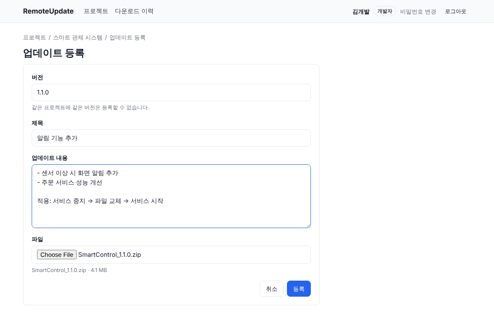

| 항목 | 설명 |
|---|---|
| **버전** (필수) | 영문 · 숫자 · `.` `+` `_` `-` 만 (예: `1.2.0`). **같은 프로젝트에 같은 버전은 다시 쓸 수 없고, 등록 후 바꿀 수 없습니다.** |
| **제목** (필수) | 한 줄 요약. 최대 200자 |
| **업데이트 내용** | 변경 사항, **적용 방법**, 주의 사항. 최대 2,000자. 현장 담당자가 이 글만 보고 적용할 수 있게 쓰세요. |
| **파일** (필수) | 배포 파일 1개. 허용 형식·최대 크기는 선택 칸 아래 표시. 형식이 틀리거나 너무 크면 고르는 즉시 빨간 글자로 알려 줌 |

**등록** → 업로드 진행률이 보이고, 끝나면 상세 화면으로 이동합니다. 서버가 파일의 SHA-256 값을 계산해 함께 보여 줍니다.

- 목록의 **최신 버전**은 "배포 중" 인 것 중 **가장 나중에 등록한 것**입니다 (버전 번호 크기가 아니라 등록 시각 기준).
- 업로드 중에는 창을 닫지 마세요. 실패하면 서버에 반쯤 올라간 파일은 남지 않으니 다시 등록하면 됩니다.

### 5.4. 업데이트 상세 (개발자 화면)

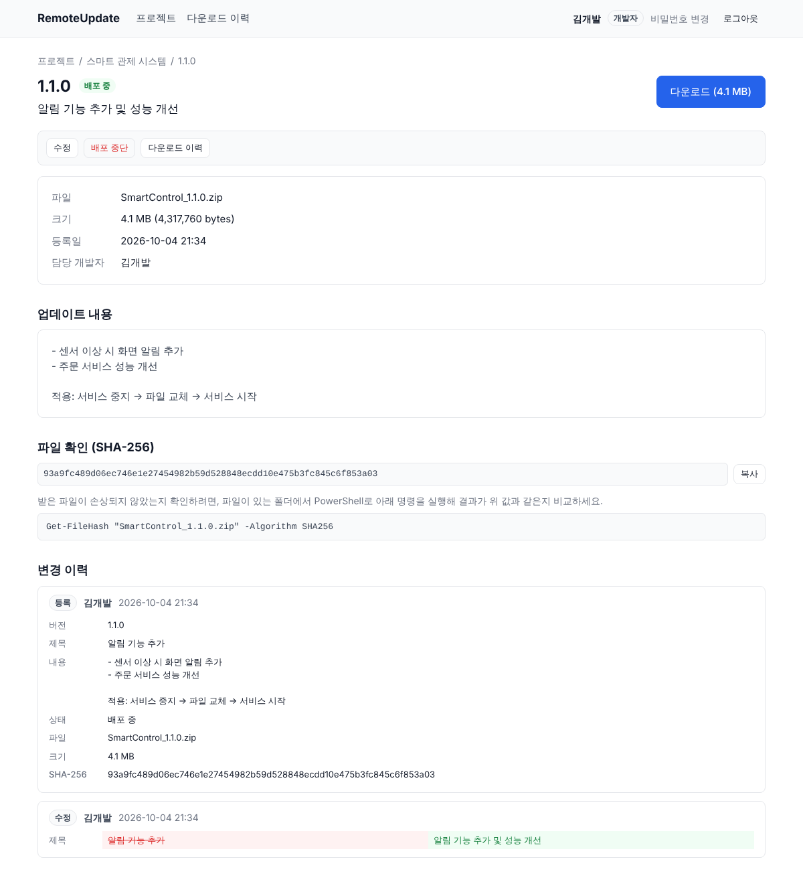

개발자에게는 다음이 추가로 보입니다.

| 기능 | 설명 |
|---|---|
| **수정** | **제목과 업데이트 내용만** 고칠 수 있습니다. 버전·파일은 바꿀 수 없으니, 파일이 잘못됐으면 **새 버전으로 등록**하고 잘못된 버전은 배포 중단하세요. |
| **배포 중단** / **배포 재개** | 문제가 있는 버전을 숨깁니다. 중단하면 직원 화면에서 사라지고 다운로드도 막힙니다. 다시 **배포 재개**하면 돌아옵니다. (삭제 기능은 없습니다 — 기록을 남기기 위함) |
| **다운로드 이력** | 이 버전을 받은 사람만 걸러서 다운로드 이력 화면으로 |
| **변경 이력** | 등록 · 수정 · 중단 · 재개를 누가 언제 했는지, 무엇이 바뀌었는지(빨간색 이전 값 → 초록색 새 값) |

배포를 중단한 버전은 이렇게 보입니다.

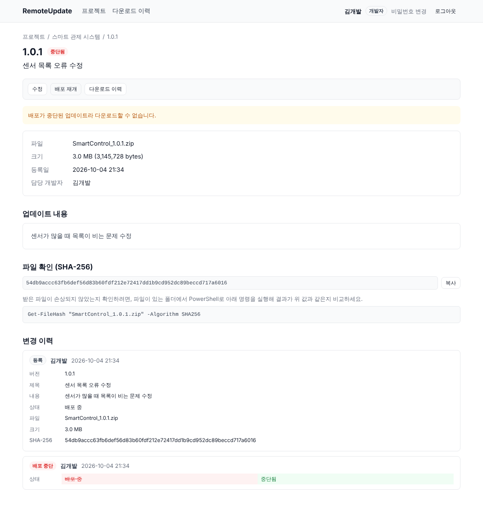

### 5.5. 다운로드 이력

상단 메뉴 **다운로드 이력**

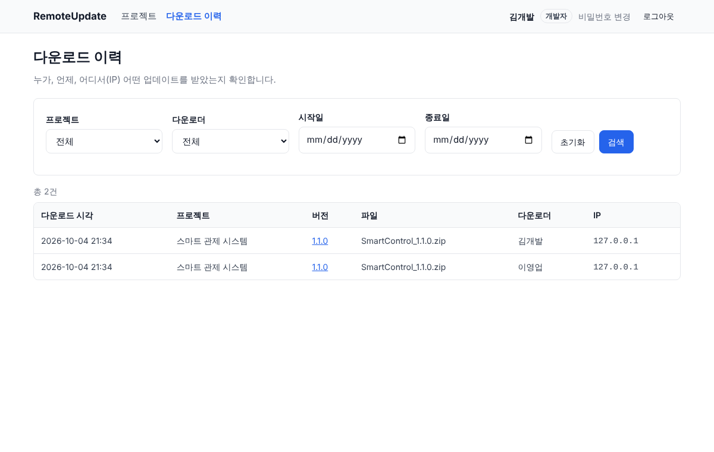

1. **프로젝트**, **다운로더**, **시작일 ~ 종료일** 로 조건을 고르고 **검색** (비우면 전체)
2. **초기화** 로 조건을 모두 지움
3. 버전을 누르면 그 업데이트 상세로 이동
4. 최신순, 한 페이지 20건. 아래쪽 페이지 번호로 이동

> 업데이트 상세의 **다운로드 이력** 버튼으로 들어오면 "업데이트 #번호 의 이력만 보는 중" 이 표시되고, **전체 보기** 로 풀 수 있습니다.

---

## 6. 관리자 — 프로젝트·사용자·허용 IP

### 6.1. 프로젝트 등록 · 수정

- **등록:** 프로젝트 목록 오른쪽 위 **프로젝트 등록**
- **수정:** 프로젝트 화면 오른쪽 위 **프로젝트 수정**

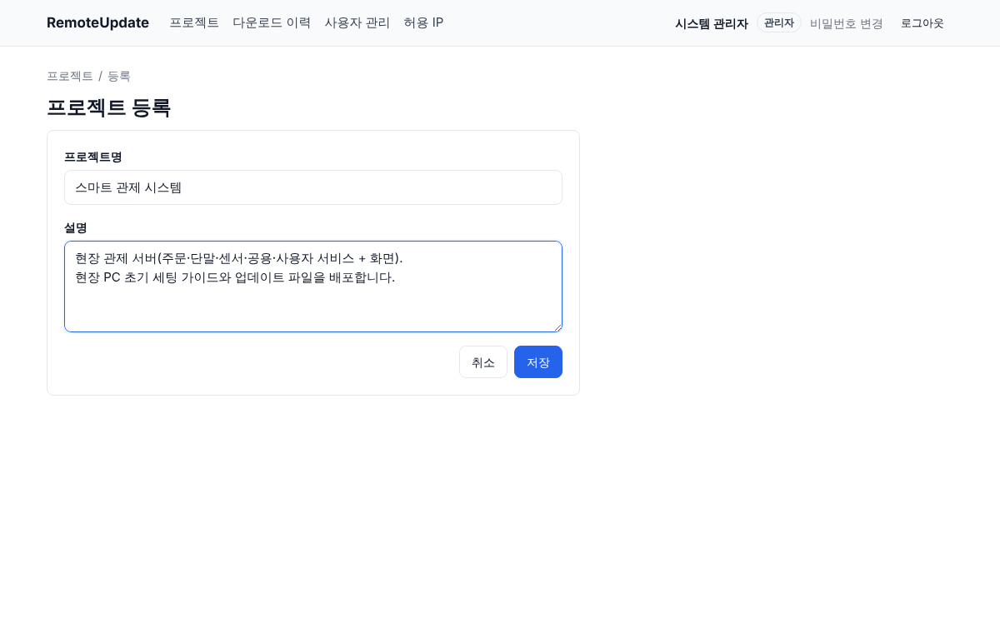

| 항목 | 설명 |
|---|---|
| **프로젝트명** (필수) | 최대 200자. **다른 프로젝트와 같은 이름은 쓸 수 없습니다.** |
| **설명** | 최대 2,000자. 목록 카드와 프로젝트 화면 위에 보임. 줄바꿈 유지 |

> 프로젝트 삭제 기능은 없습니다(가이드·업데이트·다운로드 기록 보존). 이름을 잘못 지었으면 수정하세요.

### 6.2. 사용자 관리

상단 메뉴 **사용자 관리**

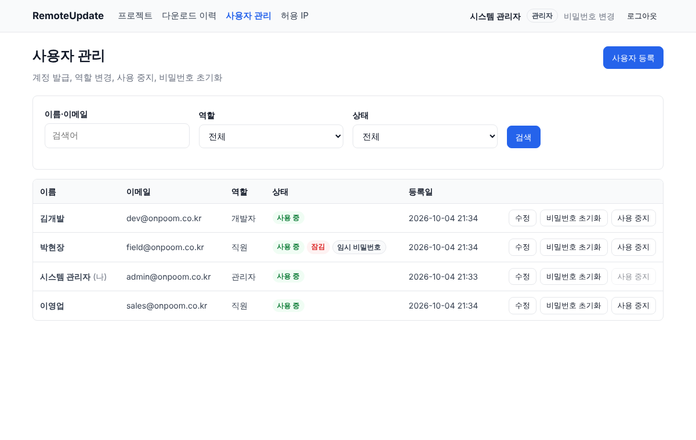

**목록과 검색**

- **이름·이메일**(일부만 입력해도 됨), **역할**, **상태**(사용 중 / 중지)로 검색
- 상태 표시:
  - **사용 중** / **중지** — 로그인 가능 여부
  - **잠김** — 비밀번호 5회 실패로 잠긴 상태 (마우스를 올리면 풀리는 시각 표시)
  - **임시 비밀번호** — 아직 첫 로그인 비밀번호 변경을 하지 않음
- 내 계정에는 **(나)** 표시

**사용자 등록**

1. 오른쪽 위 **사용자 등록**
2. **이메일**(로그인 ID, 중복 불가), **이름**, **역할**(직원 / 개발자 / 관리자) 입력 → **등록**

   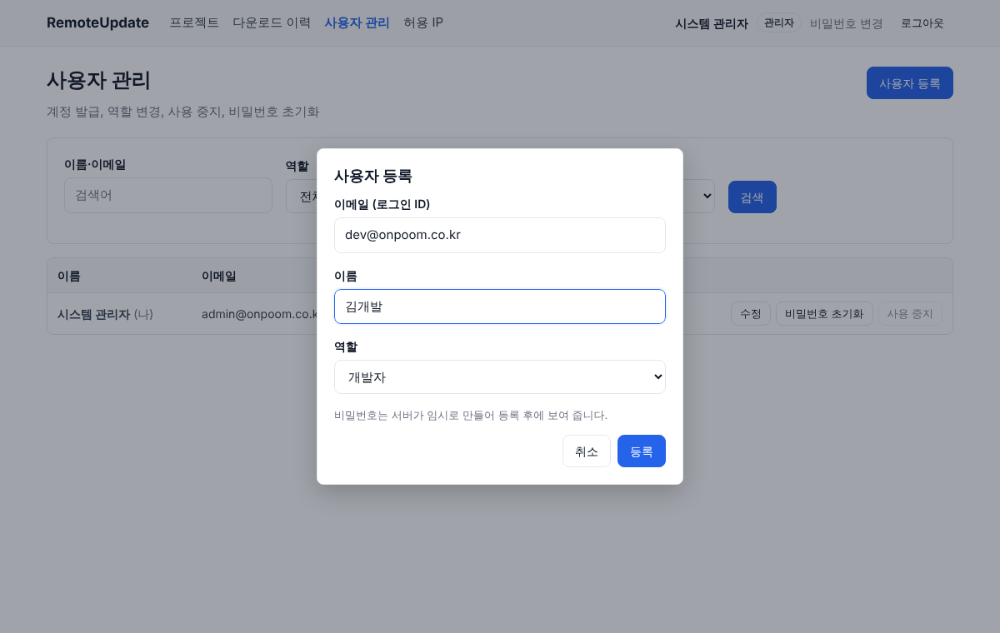

3. **임시 비밀번호**가 표시됩니다. **이 창을 닫으면 다시 볼 수 없으니** **복사** 해서 사용자에게 전달하세요(메신저 · 전화 등, 이메일 주소와 따로 보내는 것을 권장).

   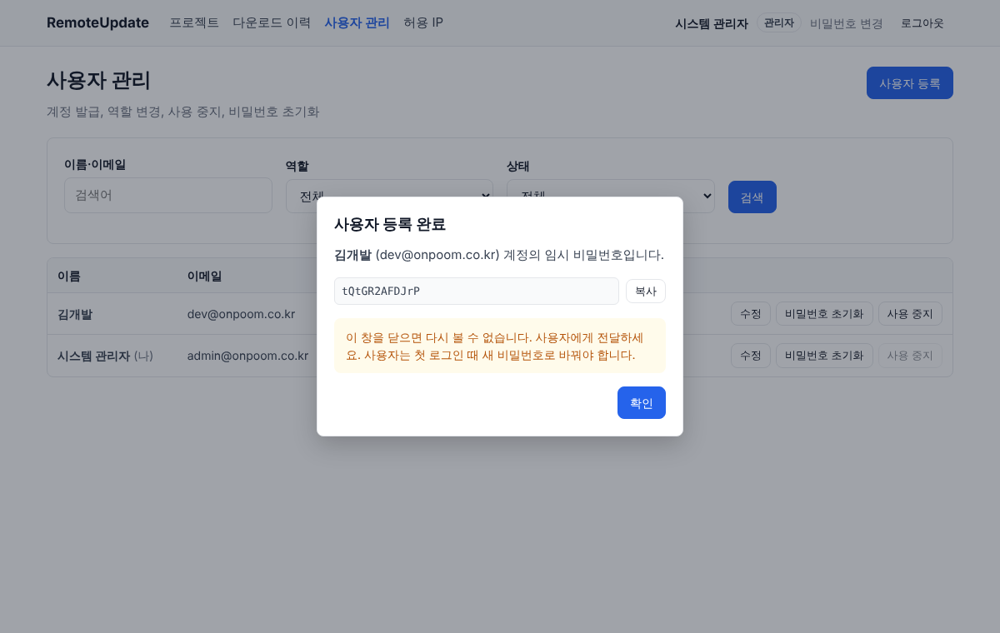

4. 사용자는 첫 로그인 때 비밀번호를 바꿔야 합니다 (→ 2.3).

**역할 선택 기준**

| 역할 | 누구에게 |
|---|---|
| 직원 | 현장에 나가 가이드를 보고 파일을 받는 사람 (영업, 현장 지원 등) |
| 개발자 | 가이드·업데이트를 올리고 관리하는 사람 |
| 관리자 | 계정·프로젝트·허용 IP 를 관리하는 사람 (최소 인원만) |

**수정 · 비밀번호 초기화 · 사용 중지**

| 버튼 | 설명 |
|---|---|
| **수정** | 이름과 역할 변경. 이메일은 바꿀 수 없음 |
| **비밀번호 초기화** | 새 임시 비밀번호 발급 + **잠금 해제**. 사용자는 다음 로그인 때 비밀번호를 바꿔야 함 |
| **사용 중지** / **다시 사용** | 퇴사·장기 미사용자는 삭제 대신 사용 중지. 중지하면 **이미 로그인한 화면도 다음 요청부터 바로 막힘** |

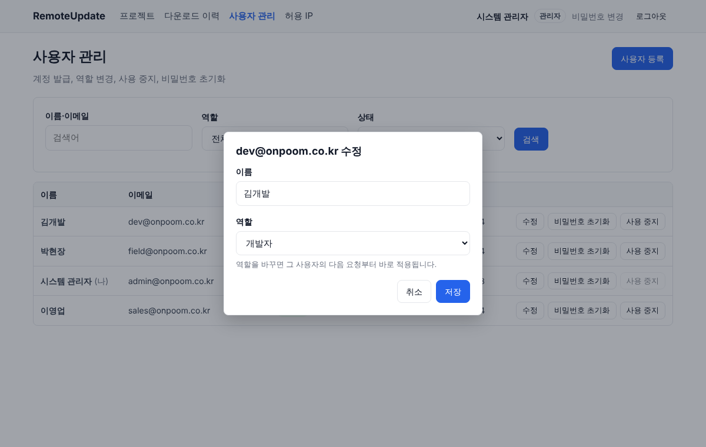

> 안전장치
> - **본인 계정**의 역할 변경·사용 중지는 할 수 없습니다 (다른 관리자에게 요청).
> - 사용 중인 **관리자가 최소 1명**은 남아야 합니다.
> - 역할을 바꾸면 그 사용자의 열린 화면에도 다음 요청부터 바로 반영됩니다.

### 6.3. 허용 IP

상단 메뉴 **허용 IP**. 등록·수정 같은 **관리 기능을 쓸 수 있는 접속 위치**를 정합니다.

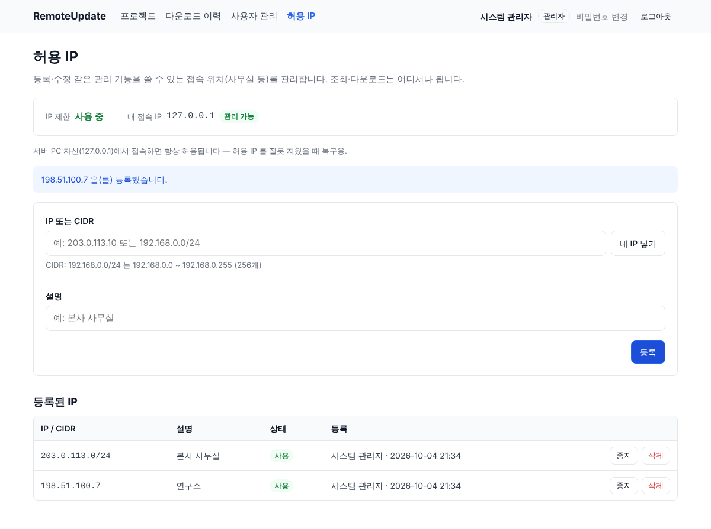

**동작 방식**

| | IP 제한 꺼짐 (기본) | IP 제한 켜짐 |
|---|---|---|
| 로그인 · 조회 · 다운로드 (모든 역할) | 어디서나 | 어디서나 |
| 등록 · 수정 · 배포 중단/재개 (데이터를 바꾸는 작업) | 어디서나 | **허용 IP 에서만** |
| 사용자 관리 · 허용 IP 화면 (조회 포함) | 어디서나 | **허용 IP 에서만** |
| 다운로드 이력 · 변경 이력 조회 | 어디서나 | 어디서나 |
| 서버 PC 자신(127.0.0.1)에서 접속 | — | 항상 허용 (복구용) |

- 화면 위 상자에 **IP 제한 사용 중 / 꺼져 있음**, **내 접속 IP**, 그리고 지금 위치가 **관리 가능**한지 표시됩니다.
- IP 제한을 켜고 끄는 것은 화면이 아니라 **서버 설정**(`IP_FILTER_ENABLED=true`)입니다. 반드시 **사무실 IP 를 먼저 등록한 뒤** 켜세요 (Backend `docs/operations.md` 12장).

**등록**

1. **IP 또는 CIDR** 입력
   - 한 대: `203.0.113.10`
   - 범위: `192.168.0.0/24` (= 192.168.0.0 ~ 192.168.0.255, 256개)
   - **내 IP 넣기** 를 누르면 지금 접속한 IP 가 채워집니다.
2. **설명**(예: 본사 사무실) 입력 → **등록**

**중지 · 삭제**

- **중지**: 기록은 남기고 잠시 허용만 끔 / **사용**: 다시 허용
- **삭제**: 완전히 지움 (확인 창이 뜸)
- 지금 내가 접속한 IP 를 허용하는 **유일한** 항목은 중지·삭제할 수 없습니다 ("다른 허용 IP 를 먼저 등록하세요"). 실수로 스스로 잠기는 것을 막기 위함입니다.

**허용되지 않은 위치에서 접속하면**

개발자·관리자 화면 위에 노란 안내줄이 뜨고, 등록·수정을 시도하면 "허용되지 않은 IP입니다." 가 나옵니다. 조회와 다운로드는 그대로 됩니다.

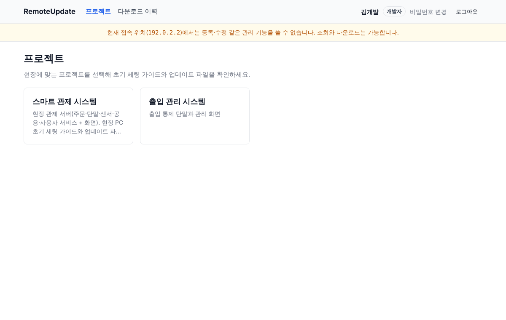

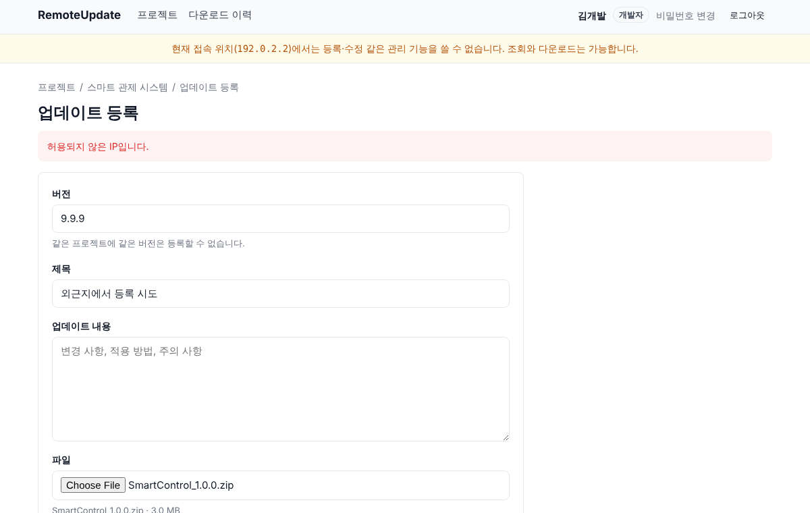

> 사무실 IP 가 바뀌어 아무도 관리 기능을 못 쓰게 됐다면: **서버 PC 에서** `http://localhost:8080` 으로 접속해(항상 허용) 새 IP 를 등록하세요. 자세한 긴급 절차는 `docs/operations.md` 12장.

---

## 7. 처음 운영을 시작할 때 (관리자 체크리스트)

1. **최초 관리자 로그인** — 서버를 처음 실행하면 관리자 계정이 하나 만들어집니다. 이메일·초기 비밀번호는 서버 설정(`ADMIN_EMAIL`, `ADMIN_PASSWORD`) 값이며, 설정하지 않았으면 Backend `README.md` 의 기본값입니다. 로그인하면 바로 비밀번호를 바꿉니다.
2. **프로젝트 등록** (→ 6.1)
3. **사용자 등록** — 개발자 계정부터 만들고 임시 비밀번호 전달 (→ 6.2). 관리자 계정을 하나 더 만들어 두면 비밀번호 분실 시 서로 초기화할 수 있습니다.
4. 개발자가 **가이드**(설치 순서대로 번호를 붙여서)와 **첫 업데이트**를 등록 (→ 5.1, 5.3)
5. 직원 계정을 만들어 **직원 화면에서 보이는지** 확인 — 직원 계정으로 로그인해 가이드 · 다운로드 · SHA-256 확인까지 한 번 해 보기
6. (선택) **허용 IP** — 사무실 IP 등록 → 서버를 `IP_FILTER_ENABLED=true` 로 재시작 → 허용 IP 화면에 "사용 중" 확인 (→ 6.3)

> 관리자 비밀번호를 잊고 다른 관리자도 없으면: 서버 설정 `ADMIN_RESET_ON_START=true` 로 한 번 실행해 복구합니다 (`docs/operations.md` 7장, 복구 후 반드시 `false`).

---

## 8. 오류 메시지와 해결

| 메시지 | 원인 · 해결 |
|---|---|
| 이메일 또는 비밀번호가 올바르지 않습니다. | 오타, Caps Lock 확인. 5번 틀리면 15분 잠김 |
| 로그인 실패 횟수를 초과해 계정이 잠겼습니다. | 15분 기다리거나 관리자에게 비밀번호 초기화 요청 |
| 사용이 중지된 계정입니다. | 관리자에게 문의 (사용자 관리에서 **다시 사용**) |
| 로그인 시간이 만료되었습니다. | 30분 동안 사용하지 않음 → 다시 로그인 |
| 현재 비밀번호가 올바르지 않습니다. | 비밀번호 변경 화면의 현재(또는 임시) 비밀번호 오타 |
| 새 비밀번호가 현재 비밀번호와 같습니다. | 다른 비밀번호로 |
| 권한이 없습니다. | 내 역할로는 쓸 수 없는 기능 → 관리자에게 역할 확인 |
| 허용되지 않은 IP입니다. | 허용된 위치(사무실)에서 다시 하거나, 관리자에게 IP 등록 요청 (→ 6.3) |
| 이 프로젝트에 같은 버전이 이미 등록되어 있습니다. | 다른 버전 번호로 등록 |
| 이미 같은 이름의 프로젝트가 있습니다. / 이미 등록된 이메일입니다. / 이미 등록된 IP 입니다. | 중복 값 → 다른 값으로 |
| 허용되지 않은 파일 형식입니다. | 허용 형식(파일 선택 칸 아래 표시)으로 압축해서 올리기 (예: zip) |
| 파일 크기가 허용 범위를 초과했습니다. | 최대 크기(기본 500MB) 초과 → 나눠서 올리거나 관리자에게 문의 |
| 다운로드가 중단된 업데이트입니다. | 배포 중단된 버전 → 최신 버전을 받기 |
| 요청 보안 토큰이 없거나 만료되었습니다. 페이지를 새로고침하세요. | `F5` 로 새로고침 후 다시 시도 |
| 활성 관리자가 최소 한 명은 있어야 합니다. | 마지막 관리자는 역할 변경·중지 불가 → 다른 관리자를 먼저 만들기 |
| 본인 계정의 역할·사용 여부는 바꿀 수 없습니다. | 다른 관리자에게 요청 |
| 서버 오류가 발생했습니다. | 잠시 후 다시 시도. 계속되면 시각과 화면을 캡처해 관리자에게 전달 |

---

## 9. 자주 묻는 질문

**Q. 업데이트를 잘못 올렸어요. 지울 수 있나요?**
삭제는 없습니다. 제목·내용은 **수정**으로 고치고, 파일이 잘못됐으면 해당 버전을 **배포 중단**한 뒤 새 버전 번호로 다시 등록하세요.

**Q. 직원 화면에 제가 올린 업데이트가 안 보여요.**
**배포 중단** 상태인지 확인하세요. 직원에게는 "배포 중" 인 버전만 보입니다.

**Q. 가이드는 지울 수 있나요?**
현재 버전에서는 삭제 기능이 없습니다. 제목을 `[사용 안 함] ...` 처럼 바꾸고 본문에 대체 가이드를 안내하세요.

**Q. 다운로드가 중간에 끊겨요.**
다시 받은 뒤 4.5 의 SHA-256 확인으로 파일이 온전한지 꼭 확인하세요.

**Q. 현장(외부)에서도 쓸 수 있나요?**
서버에 접속할 수 있는 곳이면 로그인 · 조회 · 다운로드는 됩니다. 등록·수정은 IP 제한을 켠 경우 허용 위치에서만 됩니다.

**Q. 모바일에서도 되나요?**
됩니다. 화면이 좁으면 표는 좌우로 밀어서 봅니다.

**Q. 내 역할이 무엇인지 어디서 보나요?**
오른쪽 위 이름 옆의 표시(직원 / 개발자 / 관리자)입니다.
